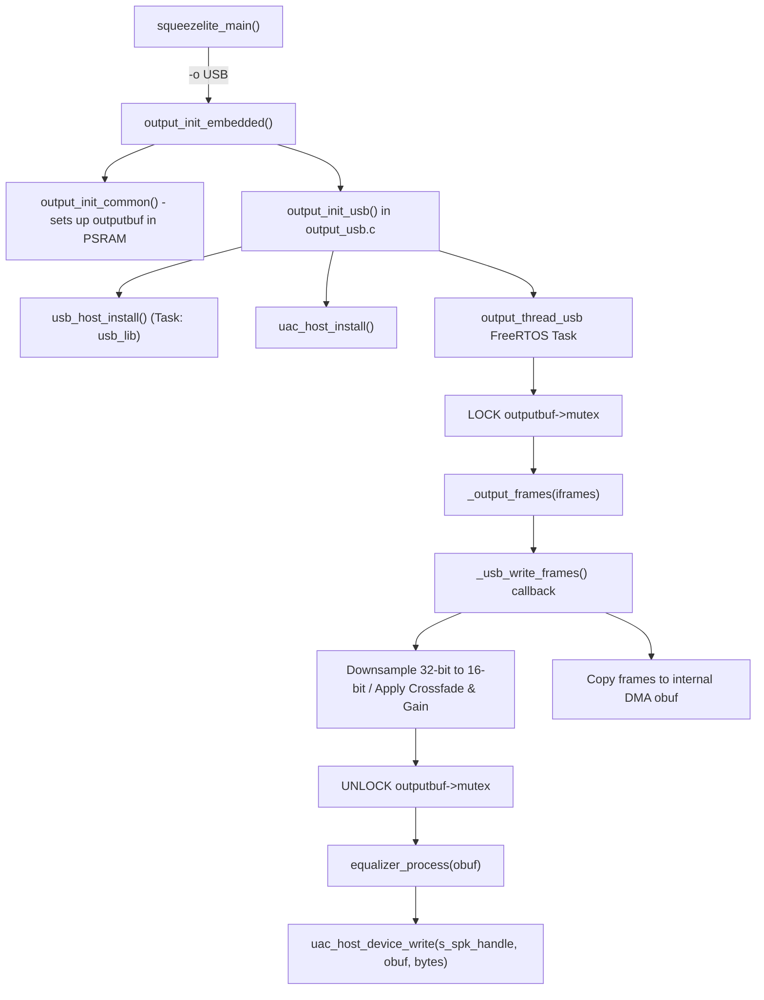

# Project Knowledge Base & Technical Insights

This document consolidates critical architectural knowledge, constraints, design choices, and pitfalls discovered during the development of the USB Audio Class (UAC 1.0) backend for `squeezelite-esp32`.

---

## 1. ESP-IDF Target & Ecosystem Compatibility

* **ESP-IDF Version**: Target repository uses **ESP-IDF v4.4.8** (branch `master-v4.3`).
* **Docker Image**: Official CI image is `sle118/squeezelite-esp32-idfv448:4.4.8`.
* **Component Manager**:
  * ESP-IDF v4.4.8 includes `idf-component-manager` by default.
  * Dependency declaration in `idf_component.yml` allows automated resolution of managed components:
    ```yaml
    dependencies:
      espressif/usb_host_uac:
        version: "^1.5.0"
        rules:
          - if: "target in [esp32s2, esp32s3, esp32p4]"
    ```
  * During build, managed components are downloaded into `managed_components/` and exposed to CMake as `espressif__usb_host_uac` and `usb_host_uac`.

---

## 2. Memory Architecture & DMA Caveats (ESP32-S3)

### The PSRAM DMA Rule
* The ESP32-S3 N16R8 has **8MB Octal PSRAM** (`CONFIG_SPIRAM_MODE_OCT=y`).
* Octal PSRAM is **NOT DMA-capable**.
* Passing a buffer residing in external PSRAM (`EXT_RAM_ATTR` or standard `malloc()` when SPIRAM allocation is active) to USB Host DMA engines causes hardware bus exceptions or silent audio corruption.
* **Solution**:
  * Squeezelite's large ring buffer (`outputbuf`, 500KB - 2000KB) resides in PSRAM (via `EXT_BSS`).
  * A dedicated intermediate staging buffer (`obuf`, `FRAME_BLOCK * BYTES_PER_FRAME` = ~8KB - ~16KB) is allocated strictly in internal SRAM using:
    ```c
    obuf = (u8_t *)heap_caps_malloc(obuf_size, MALLOC_CAP_INTERNAL | MALLOC_CAP_DMA);
    ```

---

## 3. Squeezelite Audio Pipeline & Backend Integration

### Audio Output Flow


### Key Interfaces
1. **`output.write_cb`**:
   * Function pointer called by Squeezelite's core `_output_frames()` while `outputbuf->mutex` is locked.
   * Copies audio frames from `outputbuf->readp` to `obuf`.
   * Handles sample depth differences:
     * When `DEPTH=16` (`BYTES_PER_FRAME == 4`): direct copy.
     * When `DEPTH=32` (`BYTES_PER_FRAME == 8`): downsamples 32-bit signed samples to 16-bit (`sample >> 16`).
2. **`test_open(const char *device, unsigned rates[])`**:
   * In `output_embedded.c`, specifies the sample rates supported by the device.
   * For `"USB"`: populated with `{ 44100, 0 }`.
3. **Volume Handling**:
   * `output_volume_usb(unsigned left, unsigned right)`:
   * Maps 0..65536 volume to 0..100% and invokes `uac_host_device_set_volume()`.
   * If the USB DAC supports UAC Feature Unit volume, returns `true` (hardware volume).
   * If unsupported, returns `false`, causing Squeezelite to fall back to bit-level software digital attenuation.

---

## 4. USB Host Stack & UAC 1.0 Driver Behavior

1. **USB Host Library Tasks**:
   * `usb_host_install()` requires an event-handling daemon loop calling `usb_host_lib_handle_events()`.
   * Runs as a background task (`usb_lib`).
2. **Buffer Bias Configuration**:
   * In `S3-i2s-sdkconfig.defaults`, the USB Host hardware FIFO is optimized for audio playback:
     ```
     CONFIG_USB_HOST_HW_BUFFER_BIAS_PERIODIC_OUT=y
     ```
   * This biases the FIFO space toward periodic Isochronous OUT transfers, reducing buffer underruns.
3. **Hotplug & Error Recovery**:
   * When the USB DAC dongle is detached, the UAC driver fires `UAC_HOST_DRIVER_EVENT_DISCONNECTED` or transfer error callbacks.
   * `output_usb.c` stops the stream and transitions to an idle state without crashing.
   * Upon re-connection, `UAC_HOST_DRIVER_EVENT_TX_CONNECTED` is triggered, and `start_dac_stream()` re-claims the interface and restarts audio streaming seamlessly.
